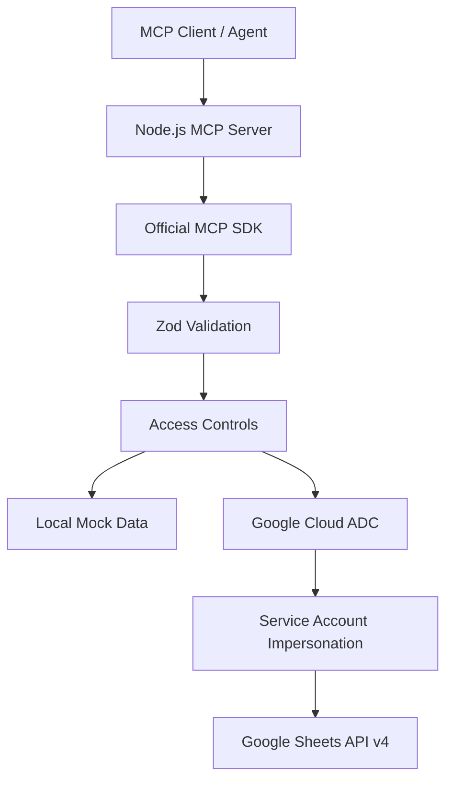

# MCP Sheets Agent

A custom Node.js Model Context Protocol (MCP) server
integrating AI agent workflows with Google Sheets API v4.

## Overview

Built to demonstrate practical MCP server development,
external API integration, secure authentication,
structured tool calls and controlled data operations.

## Architecture



## Technology Stack

- Node.js
- Official Model Context Protocol SDK
- Google Sheets API v4
- Google Cloud IAM and ADC
- Service account impersonation
- Zod validation
- JSON-RPC over stdio
- Node.js Test Runner
- Dockerfile (not yet validated)

## MCP Tools

| Tool | Description |
|---|---|
| sheets_read | Retrieve spreadsheet records |
| sheets_preview | Validate and preview a new record |
| sheets_append | Append records when writing is enabled |

Live Google Sheets access was validated in read-only mode.
Write operations were tested using local simulated data.

## Verified Results

- 8 automated tests passed
- Official MCP client-server communication validated
- Live Google Sheets API retrieval validated
- Keyless service account impersonation validated
- Input validation and access controls tested
- Simulated approval-controlled writes tested
- Zero vulnerabilities reported by the latest npm audit

## Quick Start

```bash
npm ci
npm test
npm run test:mcp
npm run demo
```

Test simulated writes:

```bash
npm run demo -- --approve
```

## Google Sheets Integration

The server supports authenticated access through
Google Application Default Credentials (ADC).

Configure an authorized demonstration spreadsheet:

```bash
export SPREADSHEET_ID="YOUR_SPREADSHEET_ID"
export SHEETS_MODE=google
export ALLOW_WRITE=false
```

Connect an MCP-compatible client to:

```bash
node src/server.js
```

The live demonstration uses a service account with
Viewer permission on the target spreadsheet.

No permanent service account private key is required.

## Security

- Read-only access by default
- Temporary access tokens
- Structured input validation
- Local credentials excluded from version control
- Mock data for write-operation testing

## Current Limitations

The current agent uses deterministic logic.
LLM integration and Docker execution are not yet validated.
Real spreadsheet writes remain disabled in the demonstration.

Per-operation approval and idempotency are planned
before enabling real write operations.

## Roadmap

- LLM-powered tool selection
- Per-operation human approval
- Idempotency and audit logging
- Docker validation
- Secure remote MCP deployment
- Additional business API integrations

## Author

Jacques Belmont

GitHub: https://github.com/jacquesbelmont

Focused on AI integrations, agentic automation,
API development and Linux/VPS infrastructure.
